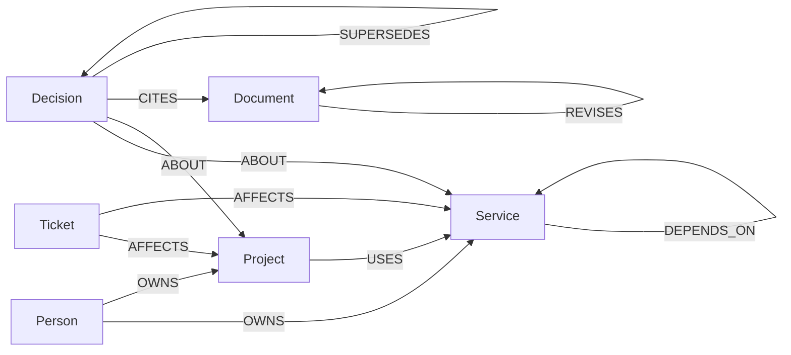

# Graph schema

Every node has a stable `semantic_id` and `type`. Source documents carry a stable source ID, immutable revision identity, content and content digest. A relationship records its own stable ID, direction, source, source revision, anchor, assertion time, validity and review state.

Dependency direction is consumer to provider. Impact follows incoming `DEPENDS_ON` edges; prerequisites follow outgoing edges. Owners are direct `OWNS` edges only. Missing ownership stays unknown.

Accepted decisions are scoped by subject and decision key. A newer decision points to its predecessor with `SUPERSEDES`. The current decision comes from a complete, connected, acyclic linear chain, not the latest timestamp. Each accepted decision links to its subject and cited immutable source revisions. Incomplete, conflicting or stale lineage cannot be treated as current.

The generated baseline has 1,000 physical nodes and 3,000 physical edges. Fixture tests verify typed endpoints, source anchors and 40 disjoint accepted decision chains. The 80 source-lineage topology is part of the synthetic fixture contract; see [`../fixtures/oracle-ledger.md`](../fixtures/oracle-ledger.md) and [`../fixtures/scenarios.md`](../fixtures/scenarios.md).
